# Dokumentasi Alur Sistem (Flowchart) & ERD Lengkap
## PT. Pena Cendekia Pustaka

Dokumen ini berisi kode dan diagram visual **Flowchart 3-Lane (Publik - Penulis - Produksi)** dan **ERD Gaya Chen / Konseptual Atribut Lengkap** yang disesuaikan secara presisi dengan sistem yang telah dibangun.

---

## 1. Flowchart Alur Sistem (3 Kolom / Multi-Lane)

Diagram alir proses bisnis end-to-end dari pengunjung publik, pendaftaran penulis, kurasi naskah, pembayaran DP 50%, pengerjaan desain editor, pratinjau proteksi, cetak mesin, hingga pelunasan dan selesai.

```mermaid
flowchart TD
    %% Styling Definisi Bentuk & Warna
    classDef terminal fill:#0F172A,stroke:#F5A623,stroke-width:2.5px,color:#FFFFFF;
    classDef process fill:#1E293B,stroke:#94A3B8,stroke-width:1.5px,color:#F8FAFC;
    classDef inputData fill:#1E3A8A,stroke:#3B82F6,stroke-width:2px,color:#FFFFFF;
    classDef decision fill:#78350F,stroke:#F59E0B,stroke-width:2px,color:#FEF3C7;
    classDef dataStore fill:#14532D,stroke:#10B981,stroke-width:2px,color:#ECFDF5;
    classDef success fill:#064E3B,stroke:#10B981,stroke-width:3px,color:#A7F3D0;

    %% ========================================================
    %% LANE 1: PUBLIK, MEMBER & KATALOG
    %% ========================================================
    subgraph LANE1 ["1. Portal Publik & Pengunjung"]
        START(["Mulai"]):::terminal
        LOG_IN[/"Login / Registrasi (Google / Email)"/]:::inputData
        DB_USER[("T_users")]:::dataStore
        VIEW_HOME["Menampilkan Halaman Beranda"]:::process
        VIEW_CATALOG["Menampilkan Halaman Katalog Buku Unggulan"]:::process
        SEARCH_BOOK[/"Pencarian Buku (Kategori, Search Bar, Filter)"/]:::inputData
        DEC_CHOOSE{"Pilih Buku?"}:::decision
        VIEW_DETAIL["Halaman Detail Buku: Sinopsis, Data Terbit & Testimoni"]:::process
        VIEW_PREVIEW["Pratinjau Sampul & Informasi Cetak"]:::process
        VIEW_INVITE["Tampil Ajakan: 'Mau Terbitkan Buku? Yuk Daftar Penulis!'"]:::process
        DEC_JOIN{"Klik Daftar Penulis?"}:::decision
        STAY_PUBLIC["Tetap di Halaman Publik sebagai Pembaca"]:::process
    end

    %% ========================================================
    %% LANE 2: REGISTRASI AUTHOR & PENGAJUAN NASKAH
    %% ========================================================
    subgraph LANE2 ["2. Pendaftaran Penulis & Pengajuan Naskah"]
        FORM_ID[/"Lengkapi Identitas: NIK, Foto KTP, No. WhatsApp & Alamat"/]:::inputData
        DB_PROFILE[("T_author_profiles")]:::dataStore
        SUBMIT_ID["Tekan Tombol Simpan Identitas"]:::process
        WAIT_VERIF["Data Tersimpan & Akun Terverifikasi Menjadi Author"]:::process
        DASH_AUTHOR["Masuk ke Ruang Kerja / Dashboard Author"]:::process
        CLICK_SUBMIT["Pilih Menu: Ajukan Naskah Baru"]:::process
        FORM_SUBMIT[/"Pilih Paket Penerbitan, Isi Judul, Kategori & Unggah Naskah"/]:::inputData
        DB_SUBMISSION[("T_submissions")]:::dataStore
        STATUS_REVIEW["Status: Menunggu Tinjauan Redaksi (pending_review)"]:::process
        ADMIN_CURATE{"Keputusan Admin Web?"}:::decision
        REVISE_NOTE["Terima Catatan Revisi & Kirim Ulang Naskah"]:::process
    end

    %% ========================================================
    %% LANE 3: FINANSIAL, PRODUKSI, CETAK & SELESAI
    %% ========================================================
    subgraph LANE3 ["3. Pembayaran, Produksi & Percetakan"]
        STATUS_WAIT_DP["Status: Menunggu Pembayaran DP 50%"]:::process
        PAY_DP[/"Bayar DP 50% & Unggah Bukti Transfer"/]:::inputData
        DB_PAYMENT[("T_payments")]:::dataStore
        STATUS_VERIF_DP["Status: Verifikasi Pembayaran DP"]:::process
        ADMIN_VERIF_DP["Admin Web Verifikasi DP 50%"]:::process
        STATUS_DESIGN["Status: Proses Desain & Layout (in_design)"]:::process
        TASK_EDITOR["Editor & Desainer Mengerjakan Layout & Cover"]:::process
        DB_DESIGN[("T_design_tasks")]:::dataStore
        AUTHOR_PREVIEW["Author Tinjau Desain di Fitur Reading View Proteksi"]:::process
        DEC_DESIGN{"Author Setujui Desain?"}:::decision
        REVISE_DESIGN["Author Kirim Catatan Revisi Desain"]:::process
        APPROVE_DESIGN["Author Beri Persetujuan Desain (Approved)"]:::process
        PRINT_NOW["Editor Klik 'Cetak Sekarang' -> Status: Percetakan (printing)"]:::process
        FINISH_PRINT["Editor Selesaikan Cetak Fisik Buku (Printed)"]:::process
        STATUS_WAIT_FINAL["Status: Menunggu Pelunasan Sisa 50%"]:::process
        PAY_FINAL[/"Bayar Pelunasan 50% & Unggah Bukti Transfer"/]:::inputData
        STATUS_VERIF_FINAL["Status: Verifikasi Pelunasan"]:::process
        ADMIN_VERIF_FINAL["Admin Web Verifikasi Pelunasan 50%"]:::process
        STATUS_COMPLETED["Status Selesai: Ceklis Hijau Emerald (completed)"]:::success
        SEND_BOOK["Penyerahan File Terbit & Pengiriman Buku Cetak ke Alamat"]:::process
        FINISH(["Selesai"]):::terminal
    end

    %% Hubungan Lane 1 (Publik)
    START --> LOG_IN
    LOG_IN -.-> DB_USER
    LOG_IN --> VIEW_HOME
    VIEW_HOME --> VIEW_CATALOG
    VIEW_CATALOG --> SEARCH_BOOK
    SEARCH_BOOK --> DEC_CHOOSE
    DEC_CHOOSE -- "Tidak" --> VIEW_HOME
    DEC_CHOOSE -- "Ya" --> VIEW_DETAIL
    VIEW_DETAIL --> VIEW_PREVIEW
    VIEW_PREVIEW --> VIEW_INVITE
    VIEW_INVITE --> DEC_JOIN
    DEC_JOIN -- "Tidak" --> STAY_PUBLIC
    DEC_JOIN -- "Ya" --> FORM_ID

    %% Hubungan Lane 2 (Pendaftaran & Pengajuan)
    FORM_ID -.-> DB_PROFILE
    FORM_ID --> SUBMIT_ID
    SUBMIT_ID --> WAIT_VERIF
    WAIT_VERIF --> DASH_AUTHOR
    DASH_AUTHOR --> CLICK_SUBMIT
    CLICK_SUBMIT --> FORM_SUBMIT
    FORM_SUBMIT -.-> DB_SUBMISSION
    FORM_SUBMIT --> STATUS_REVIEW
    STATUS_REVIEW --> ADMIN_CURATE
    ADMIN_CURATE -- "Perlu Revisi" --> REVISE_NOTE
    REVISE_NOTE --> STATUS_REVIEW
    ADMIN_CURATE -- "Diterima" --> STATUS_WAIT_DP

    %% Hubungan Lane 3 (Pembayaran & Desain)
    STATUS_WAIT_DP --> PAY_DP
    PAY_DP -.-> DB_PAYMENT
    PAY_DP --> STATUS_VERIF_DP
    STATUS_VERIF_DP --> ADMIN_VERIF_DP
    ADMIN_VERIF_DP --> STATUS_DESIGN
    STATUS_DESIGN --> TASK_EDITOR
    TASK_EDITOR -.-> DB_DESIGN
    TASK_EDITOR --> AUTHOR_PREVIEW
    AUTHOR_PREVIEW --> DEC_DESIGN
    DEC_DESIGN -- "Minta Revisi" --> REVISE_DESIGN
    REVISE_DESIGN --> TASK_EDITOR
    DEC_DESIGN -- "Setuju" --> APPROVE_DESIGN

    %% Hubungan Cetak & Pelunasan
    APPROVE_DESIGN --> PRINT_NOW
    PRINT_NOW --> FINISH_PRINT
    FINISH_PRINT --> STATUS_WAIT_FINAL
    STATUS_WAIT_FINAL --> PAY_FINAL
    PAY_FINAL -.-> DB_PAYMENT
    PAY_FINAL --> STATUS_VERIF_FINAL
    STATUS_VERIF_FINAL --> ADMIN_VERIF_FINAL
    ADMIN_VERIF_FINAL --> STATUS_COMPLETED
    STATUS_COMPLETED --> SEND_BOOK
    SEND_BOOK --> FINISH
```

---

## 2. Diagram ERD (Entity-Relationship Diagram Gaya Chen / Konseptual Atribut)

Diagram relasi entitas berikut menyajikan Entitas Utama (*Kotak Persegi*), Relasi Kardinalitas (*Belah Ketupat*), dan Atribut Data (*Bentuk Oval*) yang mengelilingi entitas persis seperti representasi ERD gambar konseptual:

```mermaid
flowchart TD
    %% Styling Kelas
    classDef entitas fill:#1E293B,stroke:#3B82F6,stroke-width:2.5px,color:#FFFFFF,font-weight:bold;
    classDef relasi fill:#7C2D12,stroke:#F59E0B,stroke-width:2px,color:#FEF3C7,font-weight:bold;
    classDef atribut fill:#0F172A,stroke:#94A3B8,stroke-width:1.5px,color:#CBD5E1;
    classDef pk fill:#064E3B,stroke:#10B981,stroke-width:2px,color:#A7F3D0,font-weight:bold;

    %% ENTITAS UTAMA
    E_USER["User / Pengguna"]:::entitas
    E_PROFILE["Profil Penulis (Author)"]:::entitas
    E_SUBMISSION["Pengajuan Naskah (Submission)"]:::entitas
    E_CATEGORY["Kategori Buku"]:::entitas
    E_TASK["Tugas Desain (Design Task)"]:::entitas
    E_PAYMENT["Pembayaran (Payment)"]:::entitas
    E_REK["Rekening Bank Penerbit"]:::entitas
    E_BOOK["Katalog Buku Unggulan"]:::entitas

    %% RELASI (BELAH KETUPAT)
    R_MEMILIKI{"Memiliki (1:1)"}:::relasi
    R_MENGAJUKAN{"Mengajukan (1:N)"}:::relasi
    R_KLASIFIKASI{"Mengelompokkan (1:N)"}:::relasi
    R_TUGAS{"Menugaskan (1:N)"}:::relasi
    R_BAYAR{"Membayar (1:N)"}:::relasi
    R_TUJUAN{"Ditransfer ke (N:1)"}:::relasi

    %% ==========================================
    %% ATRIBUT USER
    %% ==========================================
    U_ID(["<u>id</u> (PK)"]):::pk
    U_NAME(["nama_lengkap"]):::atribut
    U_EMAIL(["email (UK)"]):::atribut
    U_PASS(["password"]):::atribut
    U_ROLE(["role: admin/author/designer"]):::atribut
    U_PHONE(["no_telepon"]):::atribut
    U_GOOGLE(["google_id"]):::atribut

    E_USER --- U_ID
    E_USER --- U_NAME
    E_USER --- U_EMAIL
    E_USER --- U_PASS
    E_USER --- U_ROLE
    E_USER --- U_PHONE
    E_USER --- U_GOOGLE

    %% ==========================================
    %% ATRIBUT PROFIL PENULIS
    %% ==========================================
    P_ID(["<u>id</u> (PK)"]):::pk
    P_NIK(["nik (KTP)"]):::atribut
    P_ADDR(["alamat_lengkap"]):::atribut
    P_KTP(["foto_ktp"]):::atribut
    P_STAT(["status_profil"]):::atribut

    E_PROFILE --- P_ID
    E_PROFILE --- P_NIK
    E_PROFILE --- P_ADDR
    E_PROFILE --- P_KTP
    E_PROFILE --- P_STAT

    %% ==========================================
    %% ATRIBUT SUBMISSIONS
    %% ==========================================
    S_ID(["<u>id</u> (PK)"]):::pk
    S_CODE(["kode_naskah (UK)"]):::atribut
    S_TITLE(["judul_buku"]):::atribut
    S_PEN(["nama_pena"]):::atribut
    S_TYPE(["jenis_layanan"]):::atribut
    S_PKG(["nama_paket"]):::atribut
    S_PRICE(["harga_total"]):::atribut
    S_DP(["nominal_dp_50"]):::atribut
    S_FINAL(["nominal_pelunasan_50"]):::atribut
    S_STATUS(["status_alur"]):::atribut
    S_FILE(["file_naskah"]):::atribut

    E_SUBMISSION --- S_ID
    E_SUBMISSION --- S_CODE
    E_SUBMISSION --- S_TITLE
    E_SUBMISSION --- S_PEN
    E_SUBMISSION --- S_TYPE
    E_SUBMISSION --- S_PKG
    E_SUBMISSION --- S_PRICE
    E_SUBMISSION --- S_DP
    E_SUBMISSION --- S_FINAL
    E_SUBMISSION --- S_STATUS
    E_SUBMISSION --- S_FILE

    %% ==========================================
    %% ATRIBUT DESIGN TASK
    %% ==========================================
    T_ID(["<u>id</u> (PK)"]):::pk
    T_TYPE(["tipe_tugas: layout/cover"]):::atribut
    T_STAT(["status_pengerjaan"]):::atribut
    T_FILE(["file_hasil_desain"]):::atribut
    T_ADMIN_APP(["persetujuan_admin"]):::atribut
    T_AUTH_APP(["persetujuan_penulis"]):::atribut
    T_AUTH_NOTE(["catatan_penulis"]):::atribut

    E_TASK --- T_ID
    E_TASK --- T_TYPE
    E_TASK --- T_STAT
    E_TASK --- T_FILE
    E_TASK --- T_ADMIN_APP
    E_TASK --- T_AUTH_APP
    E_TASK --- T_AUTH_NOTE

    %% ==========================================
    %% ATRIBUT PAYMENTS
    %% ==========================================
    PAY_ID(["<u>id</u> (PK)"]):::pk
    PAY_TYPE(["tipe: dp/final"]):::atribut
    PAY_AMT(["nominal_tagihan"]):::atribut
    PAY_PROOF(["file_bukti_transfer"]):::atribut
    PAY_STAT(["status: pending/verified/rejected"]):::atribut

    E_PAYMENT --- PAY_ID
    E_PAYMENT --- PAY_TYPE
    E_PAYMENT --- PAY_AMT
    E_PAYMENT --- PAY_PROOF
    E_PAYMENT --- PAY_STAT

    %% ==========================================
    %% ATRIBUT REKENING
    %% ==========================================
    R_ID(["<u>id</u> (PK)"]):::pk
    R_BANK(["nama_bank"]):::atribut
    R_NOREK(["nomor_rekening"]):::atribut
    R_AN(["atas_nama"]):::atribut
    R_QR(["gambar_qris"]):::atribut

    E_REK --- R_ID
    E_REK --- R_BANK
    E_REK --- R_NOREK
    E_REK --- R_AN
    E_REK --- R_QR

    %% ==========================================
    %% ATRIBUT BUKU UNGGULAN
    %% ==========================================
    B_ID(["<u>id</u> (PK)"]):::pk
    B_TITLE(["judul"]):::atribut
    B_AUTHOR(["penulis"]):::atribut
    B_ISBN(["isbn"]):::atribut
    B_COVER(["gambar_sampul"]):::atribut

    E_BOOK --- B_ID
    E_BOOK --- B_TITLE
    E_BOOK --- B_AUTHOR
    E_BOOK --- B_ISBN
    E_BOOK --- B_COVER

    %% ==========================================
    %% RELASI ANTAR ENTITAS
    %% ==========================================
    E_USER ---|1| R_MEMILIKI ---|1| E_PROFILE
    E_USER ---|1| R_MENGAJUKAN ---|N| E_SUBMISSION
    E_CATEGORY ---|1| R_KLASIFIKASI ---|N| E_SUBMISSION
    E_SUBMISSION ---|1| R_TUGAS ---|N| E_TASK
    E_SUBMISSION ---|1| R_BAYAR ---|N| E_PAYMENT
    E_PAYMENT ---|N| R_TUJUAN ---|1| E_REK
    E_USER -.->|Mengerjakan| E_TASK
```

---

## 3. Cara Menggunakan Kode Mermaid Ini

1. **Pratinjau & Edit Online**:
   Buka situs [https://mermaid.live](https://mermaid.live), lalu salin (*copy-paste*) kode Mermaid di atas ke kolom editor sebelah kiri. Diagram akan langsung ter-render interaktif dan siap diunduh (*PNG*, *SVG*, *PDF*).
2. **Notion / GitHub / Visual Studio Code**:
   Cukup masukkan kode di dalam blok markdown dengan bahasa `mermaid`.
3. **Kesesuaian Sistem**:
   Semua alur proses dan atribut entitas di atas mencerminkan skema database asli di file migration Laravel dan controller PT. Pena Cendekia Pustaka.
